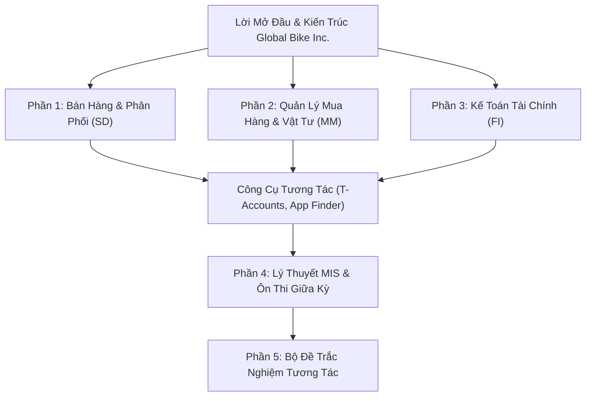

# 📘 SAP S/4HANA Fiori Interactive Master Guidebook
### 🎓 IS091IU - Management Information Systems with ERP Application
**Trường Đại học Quốc Tế – Đại học Quốc Gia TP.HCM (HCMIU - VNU-HCM)**  
*Khoa Kỹ thuật & Quản lý Hệ thống Công nghiệp (School of IEM)*

---

[](https://sap.com)
[](https://experience.sap.com/fiori/)
[](LICENSE)
[](https://pages.github.com/)

---

## 🌟 Giới Thiệu Dự Án (Project Overview)

Đây là **Cuốn sách hướng dẫn tương tác kỹ thuật số (Interactive Digital Handbook & Field Manual)** hoàn chỉnh dành cho sinh viên và học viên thực hành môn học **Hệ Thống Thông Tin Quản Lý (IS091IU)** trên nền tảng **SAP S/4HANA 2023 (Giao diện web SAP Fiori 3.0)** dựa trên mô hình doanh nghiệp giả lập **Global Bike Inc. (GBI)**.

Cuốn sách bao gồm hơn **50 bước thực hành chuẩn hóa**, tích hợp bảng tài khoản chữ T (T-Accounts), giải thích chi tiết các mã chứng từ, mã vận động, câu hỏi báo cáo thực hành Nhóm 7 và bộ câu hỏi trắc nghiệm ôn thi giữa kỳ (Midterm Exam Prep).

---

## ✨ Các Tính Năng Nổi Bật (Key Features)

- 🔢 **Đổi Số Hiệu Học Viên Tự Động (`###` Dynamic Replacer):**
  - Nhập số định danh cá nhân của bạn (ví dụ: `180` hoặc `007`) vào ô công cụ ở thanh bên trái.
  - Toàn bộ tên đối tác (`The Bike Zone ###`, `Mid-West Supply ###`), mã vật tư (`CHLK1###`, `DXTR1###`), mã tài khoản (`7403###`, `3300###`) trên toàn bộ trang web sẽ tự động cập nhật theo số của bạn theo thời gian thực!
- ⚖️ **Mô Phỏng Sơ Đồ Kế Toán Chữ T (Interactive T-Accounts):**
  - Trực quan hóa dòng tiền tệ, hàng hóa và công nợ qua từng bước cho cả 3 chu trình:
    1. Chu trình mua hàng MM (Procure-to-Pay)
    2. Chu trình bán hàng SD (Order-to-Cash)
    3. Chu trình chi phí thuê mặt bằng FI-AP (Rent Accounting)
- 🔍 **Bộ Tra Cứu Ứng Dụng Fiori (Fiori App Finder & T-Codes):**
  - Tra cứu tức thì hơn 25 ứng dụng web Fiori theo tên, vai trò người dùng (Role) hoặc mã giao dịch truyền thống (T-Codes: `MIGO`, `MIRO`, `VA01`, `FB50`, `F-53`, `BP`...).
- 📝 **Luyện Thi Trắc Nghiệm Midterm Tương Tác (Interactive Quiz):**
  - 10+ câu hỏi trắc nghiệm thực tế bám sát cấu trúc đề thi giữa kỳ tại HCMIU và tài liệu Studocu, chấm điểm và hiện giải thích chi tiết tức thì.
- 🎨 **Đa Dạng Giao Diện (Theme Switcher):**
  - Hỗ trợ chế độ Sáng (Light), Tối (Dark) và Đọc sách bảo vệ mắt (Sepia).
  - Tích hợp thanh đo tiến độ đọc và nút In / Xuất PDF định dạng chuẩn sách giáo trình.
- 💾 **Lưu Tiến Độ Thực Hành (Local Checkpoints):**
  - Tích chọn hoàn thành từng bước trong phòng lab, hệ thống tự động ghi nhớ trạng thái trên trình duyệt (`localStorage`).

---

## 📚 Nội Dung Các Chương Trong Sách



### 1. Phân Hệ Bán Hàng & Phân Phối (Sales & Distribution - SD)
- **Quy trình chuẩn Order-to-Cash (OTC):**
  `Inquiry (IN)` ➔ `Quotation (QT)` ➔ `Sales Order (OR)` ➔ `Outbound Delivery` ➔ `Picking & Post Goods Issue (WL)` ➔ `Billing Document (RV)` ➔ `Incoming Payment (DZ)` ➔ `Document Flow`.
- **5 Bài thực hành SD Exercises (SD 1 - 5):** Khách hàng Beantown Bikes (`1000`).
- **14 Bước Case Study chi tiết:** Khách hàng The Bike Zone `###`, xuất bán 5 xe Deluxe Touring Bike và 2 xe Professional Touring Bike, giảm giá 5%, hạch toán doanh thu và thu hồi nợ $20,092.50 USD.

### 2. Phân Hệ Quản Lý Vật Tư (Materials Management - MM)
- **Quy trình chuẩn Procure-to-Pay (P2P):**
  `Purchase Requisition (PR)` ➔ `Request for Quotation (RFQ)` ➔ `Bid Evaluation` ➔ `Purchase Order (PO)` ➔ `Goods Receipt (WE - 101)` ➔ `Quality Inspection Transfer (321)` ➔ `Invoice Verification (RE)` ➔ `Payment (KZ)`.
- **5 Bài thực hành MM Exercises (MM 1 - 5):** Nhà cung cấp Olympic Protective Gear (`101999`).
- **24 Bước Case Study chi tiết:** Nhà cung cấp Mid-West Supply `###`, tạo mã vật tư khóa xích `CHLK1###`, nhập kho 2 đợt (Đợt 1 qua kiểm định chất lượng, Đợt 2 trực tiếp vào kho tự do), ghi nhận 2 hóa đơn và tất toán $6,400.00 USD. Giải thích 10 loại kho trong SAP.

### 3. Phân Hệ Kế Toán Tài Chính (Financial Accounting - FI)
- **Nguyên lý Kế toán S/4HANA:** Bảng tài khoản `GL00`, Sổ cái (GL) vs Sổ phụ (AP/AR), Tài khoản đối ứng (Reconciliation Accounts).
- **3 Bài thực hành FI Exercises (FI 1 - 3):** Khảo sát bảng tài khoản và báo cáo tài chính `F.01`.
- **12 Bước Case Study chi tiết (FI-AP):** Tạo tài khoản ngân hàng phụ `18100##`, tài khoản đối ứng `3300###`, tài khoản chi phí thuê `7403###`, tạo đối tác Landlord `###`, điều chuyển $100,000 USD quỹ vốn, hạch toán hóa đơn tiền thuê $1,500 USD và thanh toán qua ngân hàng.

### 4. Lý Thuyết MIS & Ôn Thi Giữa Kỳ
- Mô hình 5 áp lực cạnh tranh của Michael Porter (Porter's Five Forces: Boeing/Airbus, Walmart, Luxury, Pharma).
- 4 Chiến lược cạnh tranh cơ bản (Cost Leadership, Differentiation, Cost Focus, Differentiation Focus).
- So sánh Phần cứng (Hardware) vs Phần mềm (Software).
- Bảng tra cứu toàn bộ mã chứng từ (`WE`, `RE`, `KZ`, `KR`, `WL`, `RV`, `DZ`, `IN`, `QT`, `OR`) và mã vận động (`101`, `321`, `601`).
- Tổng hợp lời giải và câu trả lời chất vấn từ Báo cáo thực hành Nhóm 7 (HCMIU).

---

## 🚀 Hướng Dẫn Chạy Trang Web (How to Run)

Trang web được thiết kế theo kiến trúc **Vanilla Web hiện đại (HTML5 + CSS3 + JavaScript)**, hoàn toàn độc lập, không cần cài đặt framework hay môi trường phức tạp:

### Cách 1: Mở Trực Tiếp Trên Trình Duyệt (Offline)
1. Tải thư mục này về máy.
2. Nhấp đúp chuột vào file [`index.html`](index.html) để mở trên Chrome, Edge, Safari hoặc Firefox.

### Cách 2: Chạy Qua Local Server (Python)
Nếu bạn có cài đặt Python, mở terminal tại thư mục này và chạy:
```bash
python -m http.server 8080
```
Sau đó truy cập: [http://localhost:8080](http://localhost:8080)

---

## 🌐 Hướng Dẫn Đưa Lên GitHub & Kích Hoạt GitHub Pages (Web Online Miễn Phí)

Để đưa dự án này lên GitHub và chia sẻ đường link online cho bạn bè và giảng viên:

### Bước 1: Tạo Repository Mới Trên GitHub
1. Đăng nhập vào [GitHub](https://github.com/) và bấm vào nút **New** (Tạo repo mới).
2. Đặt tên Repository: ví dụ `sap-fiori-guidebook` hoặc `IS091IU-SAP-Guide`.
3. Chọn chế độ **Public**, sau đó nhấn **Create repository**.

### Bước 2: Upload Toàn Bộ File Lên GitHub
- **Cách đơn giản nhất (Kéo thả):**
  1. Trên trang repo vừa tạo, nhấn vào dòng **"uploading an existing file"**.
  2. Kéo thả các file sau vào trình duyệt:
     - `index.html`
     - `styles.css`
     - `app.js`
     - `README.md`
     - `.gitignore`
  3. Nhấn nút xanh **Commit changes** ở dưới cùng.

### Bước 3: Bật Tính Năng Website Online (GitHub Pages)
1. Trong Repository trên GitHub, vào tab **Settings** (ở trên cùng).
2. Ở menu bên trái, cuộn xuống chọn mục **Pages**.
3. Tại phần **Branch**:
   - Chọn nhánh **`main`** (hoặc `master`).
   - Thư mục chọn **`/(root)`**.
   - Bấm **Save**.
4. Chờ khoảng 1 - 2 phút, GitHub sẽ cung cấp cho bạn một đường link website chạy trực tiếp dạng:
   ```text
   https://<ten-username-cua-ban>.github.io/<ten-repository>/
   ```
   *(Bất kỳ ai nhấp vào link này đều có thể đọc cuốn sách trên điện thoại hoặc máy tính!)*

---

## 📂 Cấu Trúc Thư Mục (File Structure)

```text
sap-fiori-guidebook/
│
├── index.html               # Giao diện chính của cuốn sách (266 KB nội dung)
├── styles.css               # Hệ thống định dạng giao diện Fiori Horizon & Book mode
├── app.js                   # Logic xử lý tương tác (Student ID Replacer, T-Accounts, Quiz, App Finder)
├── README.md                # Tài liệu giới thiệu dự án hiển thị trên GitHub
├── .gitignore               # Tệp loại trừ file tạm thời
└── scripts/                 # Các script hỗ trợ biên soạn và trích xuất dữ liệu
```

---

## 👨‍💻 Thông Tin Tác Quyền & Đóng Góp

- **Học phần:** Management Information Systems with ERP Application (IS091IU)
- **Tài liệu tham khảo:** Giáo trình SAP University Alliances (S/4HANA 2023, Global Bike v4.3.1) của SAP UCC Magdeburg, Báo cáo thực hành nhóm G07 HCMIU và tài liệu tổng hợp Studocu.
- **Bản quyền:** Mã nguồn được chia sẻ miễn phí phục vụ mục đích học tập và nghiên cứu học thuật (MIT License).
